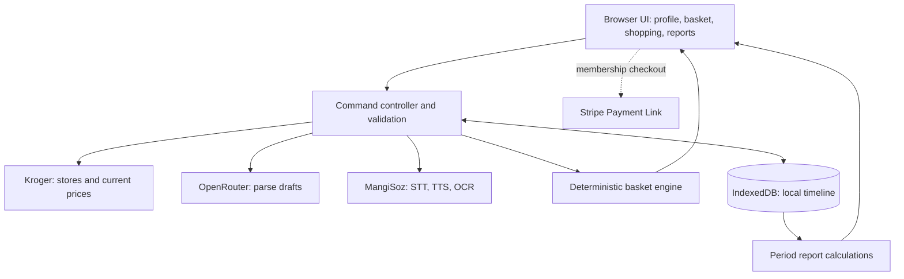

# Pro Groceries — Hackathon system design

**Date:** November 14, 2026.  
**Status:** Implemented. The app in `app/` follows this design; where the shipped behavior differs, the text below says so and the [README](README.md) is the source of truth for how to run it and what is known to be limited. The automated tests use mocked providers; they are not an authenticated end-to-end check against live Kroger prices.  
**Build constraint:** Two people, 24 hours; a working browser prototype with real service integrations and no custom application backend.  
**Product:** Same requested basket, lower checkout cost, at one Kroger store.

This document applies the latest decisions to the [feature specification](pro-groceries-features.md). It supersedes the server, cache and storage choices in the [earlier architecture](docs/archive/pro-groceries-architecture.md). The earlier flow board and user-flow documents are archived in [docs/archive/](docs/archive/) and are superseded.

## 1. Architecture decision

Build a TypeScript browser application. React with Vite is the proposed UI setup; the important constraint is a static frontend. Deploy its static assets to an HTTPS host. All matching rules, basket calculations, state transitions and reports run in the browser. External providers host their own APIs.

| Component | Responsibility | Runs where |
|---|---|---|
| Frontend | Profile, list, confirmations, results, shopping checklist, reports | Browser |
| Command controller | Turns validated text/voice/photo drafts into basket actions | Browser |
| Basket engine | Eligibility checks, package counts, cheapest valid choice, totals | Browser |
| IndexedDB | Profile versions, baskets, price observations, edits, shopping events | Browser |
| Kroger | Stores, products and store-specific prices | Kroger service |
| OpenRouter | Structured list/command parsing and optional report narrative | External inference API |
| MangiSoz | Speech recognition, speech playback and receipt/text OCR | External speech/OCR API |
| Stripe Payment Link | Optional test subscription checkout | Stripe-hosted page |

There is no Next.js API, application server, Redis, Supabase, background worker or cloud user database in this version. OpenRouter is an inference service, not the place where we host our application or grocery data.



**Feasibility gate:** direct requests require each provider to permit the frontend origin through CORS. Documentation establishes request shapes; successful authenticated browser calls remain unverified. A static app also cannot hide a shared API secret from its operator. The controlled demo credential plan is in section 6.

## 2. Location: ZIP code and a labelled pilot market

The shipped app does **not** use device geolocation (an earlier draft of this section did; the button did nothing useful and was removed). The shopper enters a ZIP code, defaulting to `45202`.

1. Query Kroger-family stores around the ZIP and let the shopper pick one real returned branch. Never invent a store ID.
2. Show **“Pilot market: <city>, <state>”**, taken from the address of the first store returned, never hardcoded. In demo mode the stores are always the three Cincinnati demo stores, and the label says so.
3. An invalid ZIP is rejected with a message; the stores already shown stay usable.

| Field | Meaning | Storage |
|---|---|---|
| `zip` | Five-digit US ZIP the shopper entered | Basket snapshot |
| `store` | `{ id, name, address, city, state, chain, source }` as returned by the locations API (or the labelled demo catalog) | Basket snapshot |

## 3. Feature design and user flow

Voice input and a **Read aloud** action are available across our screens. They use one shared control rather than separate voice implementations for every feature. Text and manual controls remain usable if speech fails. Audio is push-to-talk, with visible recording and stop controls.

| Feature / flow step | User action | System behavior |
|---|---|---|
| **01 — Location and household profile** | Allow location; confirm demo market; answer optional questions by voice/text | Save profile version: age range, household size, adults/children, lifestyle/cooking frequency, budget, shopping frequency, dietary constraints and brand locks. Explicit preferences control substitutions; age or family status never silently changes the basket. |
| **F01 — Create list** | Type, paste or dictate groceries; choose sample list if needed | MangiSoz transcribes audio; OpenRouter returns editable structured lines. Sample lists contain names and quantities, never prices. Ask about missing essentials rather than guessing. |
| **F02 — Select store** | Pick a returned Cincinnati Kroger branch | Fetch product candidates and prices directly for that `storeId`. Store each observed price and retrieval time in the local timeline. |
| **F03 — Confirm intended products** | Confirm an exact match or choose among up to three candidates | Establish the actual original product, variant and requested quantity. This confirmation still applies even when the shopper has no previous prices. |
| **05 — Optional initial-price reference** | Supply previous prices or a receipt, if available | Show only when initial prices exist. Confirm extracted values and dates; store as historical/user-supplied references. Skip this block otherwise. Never require historical prices to run a comparison. |
| **F04 — Agent chooses** | Ask to optimize the basket | Apply every cheaper eligible replacement automatically. AI interprets intent; deterministic rules decide equivalence, quantity and cost. Unknown required attributes mean no swap. |
| **F05 — Review results** | Inspect swaps; say/type “keep my original Tide” | Apply locks and recalculate immediately. Display both totals, saving, coverage, branch and price timestamps. Ambiguous commands require clarification. |
| **F06 — Shopping checklist** | Shop, check items, copy or share | Generate checklist from the chosen basket version. Spoken commands can mark specific lines as purchased. |
| **13 — Photo/voice purchase marking** | Upload receipt/text photo or say what was purchased | OCR/transcription creates a draft of matched purchased items. Confirm uncertain matches. Only explicit confirmation records a shopping event. A photo alone never proves a saving. |
| **16 — Edit saved basket** | Change items or quantities by voice/text | Preview the interpreted edit, create a new basket version, fetch current prices for the comparison, rerun the engine and save the result. |
| **Period report** | Select week/month/date range; ask a question by voice/text | Compute totals from stored events, then optionally ask AI to explain those computed facts and suggest eligible basket changes. Proposed edits follow the same confirmation and optimization path. |
| **Generate current price list** | Ask “price my usual basket now” | Fetch fresh store prices and generate a dated list. A historical price list is explicitly labelled historical. |

**Important distinction:** step 05 is conditional on supplied initial prices. F03 product identity confirmation is a separate step. The headline saving always compares the confirmed original and chosen alternatives using prices fetched for the current comparison, not an old receipt against today's promotion.

## 4. Basket engine and agent boundaries

The “agent” is a browser controller with a small allowed set of actions: parse list, ask a question, search products, optimize, lock/unlock, edit, mark purchased, refresh prices and request a report. It does not need multiple agents or an autonomous background service.

```text
Voice → MangiSoz transcript ┐
Text → original text       ├→ structured draft → validation → clarification/confirmation
Photo → OCR text           ┘                                  ↓
                                     allowed action → API calls → engine → DB → UI
```

Use a JSON schema for parsed lines and commands. Allow unknown attributes to be `null`. Reject unexpected actions and invalid quantities. AI output does not supply trusted prices, product IDs, totals or evidence of a purchase. Resolve product references against actual returned retailer products.

The engine preserves the canonical feature rules:

- Same product type and all required variants; explicit diet restrictions and locks always apply.
- Compare only compatible units; unknown pack sizes or required attributes prevent swapping.
- Cover the full requested quantity with whole packages: `packageCount = ceil(requestedAmount / packAmount)`.
- Compute money in integer cents; `lineCost = packageCount × eligiblePackagePrice`.
- A lower unit price only wins if the checkout cost for the required quantity is lower.
- Use a promotion only when its conditions are known and satisfied. Unknown coupon, loyalty or multi-buy conditions do not become unconditional savings.
- Choose the cheapest eligible candidate **among the products fetched**, without claiming a market-wide minimum.
- Missing prices are unpriced, never zero; both totals use the same covered lines. Display coverage.
- Keep fresh goods sold by weight unchanged; follow the feature specification's unsupported-category rules.

All valid swaps are applied by default. The shopper can always keep the original. Narrative explanations and spoken readouts use the engine's computed numbers.

## 5. API contracts and source of data

### Kroger — live grocery data

| Operation | Request | Demo handling |
|---|---|---|
| Get application token | `POST https://api.kroger.com/v1/connect/oauth2/token` | Operator obtains outside the browser using client credentials and permitted scopes; supplies the short-lived bearer token for the session. |
| Find stores | `GET https://api.kroger.com/v1/locations?filter.zipCode.near=45202` | Display real returned branches. |
| Find priced products | `GET https://api.kroger.com/v1/products?filter.term=<query>&filter.locationId=<storeId>` | URL-encode parameters; normalize returned product, pack and price fields. |

Data requests use `Authorization: Bearer <access_token>`. Confirm the app's actual scopes, token expiry, quotas and available fields. Indexed partner documentation is not proof that this team's application has every partner capability. [Kroger documentation](https://developer.kroger.com/documentation), [product search](https://developer.kroger.com/documentation/api-products/partner/products/product-search).

Each comparison or explicit refresh requests current prices. Historical IndexedDB observations support reports, not a live-price cache. Deduplicate identical in-flight requests and cap concurrency. If a refresh fails, preserve the old result as historical and show the failure. The comparison records its retrieval interval because separate API calls are not an atomic retailer snapshot.

### OpenRouter — parsing and report explanations

`POST https://openrouter.ai/api/v1/chat/completions`, authenticated with a session API key. Choose a currently available model supporting strict JSON-schema output; use `response_format.type = "json_schema"` and provider parameter support checks. Validate the result locally before acting. [API reference](https://openrouter.ai/docs/api_reference/overview), [structured outputs](https://openrouter.ai/docs/guides/features/structured-outputs).

Send only the list, relevant explicit preferences, allowed actions and necessary report aggregates. Do not send device coordinates or the complete user timeline. Report calculations happen before the model call; the model explains the supplied facts. Use deterministic report text if inference fails.

### MangiSoz — voice and text-photo extraction

Base URL: `https://mangisoz.nu.edu.kz/backend`.

| Service | Path after base URL | Request and response |
|---|---|---|
| Speech to text | `POST /api/v1/stt/audio/transcriptions` | Multipart `file`, optional `language`, `prompt`, `response_format=json`; response includes `text`. Use **`Authorization: Bearer <MangiSoz API key>`** on this route; `X-API-Key` is explicitly rejected here. |
| Read aloud | `POST /api/v1/tts/audio` | `text`, `lang`, optional `speaker`; binary WAV response. Use the documented general API-key auth, e.g. `X-API-Key`. OpenAPI declares form-urlencoded while prose says multipart: verify the accepted encoding in the first service test. |
| Receipt/text photo | `POST /api/v1/ocr/image` | Multipart `file`, `mode=text`; read `data.text`. Use documented general API-key auth, e.g. `X-API-Key`. |

Contracts inspected from the [public API documentation](https://mangisoz.nu.edu.kz/backend/api-docs/en) and [OpenAPI schema](https://mangisoz.nu.edu.kz/backend/openapi_public.en.json). Authenticated calls, browser CORS, supported recorded audio formats and recognition quality still need testing with the supplied key.

For this demo, a photo means a readable receipt or written list. OCR is not general fridge-object recognition. Release raw recordings/photos after processing unless the shopper explicitly keeps them. Read aloud starts on a tap; cancel previous playback when starting a new reading.

### Stripe — membership checkout

Membership is **`$49/year`** (the offer) or **`$5.99/month`**, with the guarantee “Save 5× your membership or get your money back”. Each is a Stripe-hosted **test-mode Payment Link** (`VITE_STRIPE_PAYMENT_LINK` for the year, `VITE_STRIPE_PAYMENT_LINK_MONTHLY` for the month). Opening a link needs no app backend and no Stripe secret in the browser. [Stripe Payment Links](https://docs.stripe.com/payment-links).

Free: the cheaper basket, shopping list, locks and one re-pricing. Member: weekly re-pricing, the savings counter and the Weekly report with Price watch. The member flag is stored in IndexedDB and set when Stripe returns the shopper to `#plan?checkout=success` (add `&period=month` to the monthly link's success URL). **A return URL is not payment verification.** With no server the flag only gates the demo on this device, and anyone can type the URL. A real launch verifies the payment server-side. Automatic background re-pricing is not implemented: “weekly” means the member re-prices in one tap whenever they like.

## 6. Credentials, CORS and hosting

This is an **operator-controlled hackathon demo**, not a public app distributing the team's API credentials.

- A demo setup panel accepts an OpenRouter key, MangiSoz key and short-lived Kroger token into memory. Never commit them, include them in frontend build variables, put them in URLs or persist them in IndexedDB/localStorage.
- Reloading preserves the basket/history but requires re-entering session credentials. Token expiry produces a visible reconnect state; no browser client-secret exchange is attempted.
- OpenRouter also documents browser OAuth PKCE with user-controlled keys; this is an optional later setup improvement, not a required shopper login. [OAuth PKCE](https://openrouter.ai/docs/guides/overview/auth/oauth).
- The Kroger client secret stays outside the browser. A local operator token-generation helper is preparation tooling, not a hosted application backend.
- Any credential used by browser code is visible to that browser's operator. Public unattended access with protected shared provider keys requires a different architecture.

Host the static frontend over HTTPS, for example on Vercel or Netlify. The host serves assets; provider APIs stay on their own domains. Use a fixed demo origin for the integration test and demo so the IndexedDB history remains available.

**First integration gate:** from that actual origin, make one authenticated locations request, one priced-product request, one parse request, one audio transcription, one WAV request and one OCR request. Test returned data access, not just an OPTIONS response or a successful terminal call.

If a provider blocks browser access, do not claim the integration works. Prefer provider origin authorization if offered. A local development proxy is an explicit fallback requiring a relay and would change the strict direct-browser design; a hosted static app cannot bypass CORS with `no-cors`. No relay is part of this plan unless the constraint is revised.

## 7. Browser database and time-series history

Use **IndexedDB**, an asynchronous transactional browser database, for structured local history. It belongs to the current origin/browser; it does not provide cross-device sync or guaranteed cloud persistence. [IndexedDB documentation](https://developer.mozilla.org/en-US/docs/Web/API/IndexedDB_API).

| Object store | Essential fields | Purpose |
|---|---|---|
| `profileVersions` | `id`, `profileId`, preferences, reported/shopping location, `recordedAt` | Preserve changes in explicit constraints. |
| `basketVersions` | `id`, `basketId`, version, profile version, store, requested lines, locks, chosen products, `createdAt` | Reconstruct each edited basket. |
| `priceObservations` | `id`, comparison ID, store/product/item IDs, regular/promo/eligible price, size, conditions, `fetchedAt` | Time series of actual retailer observations. |
| `comparisons` | `id`, basket version, observation references, covered lines, both totals, saving, fetch start/end | Explain exactly where a displayed estimate came from. |
| `commands` | `id`, input source, confirmed structured action, basket version, `recordedAt` | Explain a voice/text/photo edit; avoid retaining raw media by default. |
| `shoppingEvents` | `id`, basket/comparison ID, confirmed purchased lines, `occurredAt`, `recordedAt`, source, actual paid values if provided | Distinguish planned baskets, confirmed shopping and receipt evidence. |

Store timestamps in UTC; display shopping weeks in `America/New_York` for the Cincinnati demo. Apply the original one-counted-entry-per-basket-per-calendar-week rule with a unique indexed key and a transaction. Corrections update the counted event rather than adding another saving. Repricing and checklist taps alone never increase the counter.

The counter includes estimated savings only for confirmed purchased, substituted lines with both comparable prices. Partial shopping counts only those lines. Receipt-paid amounts are separate actual-spend observations; a receipt does not prove what an unpurchased alternative would have cost.

Provide **Clear my data** and a JSON history export/import for the demo operator. Any seeded multiweek history is visibly labelled **demo history** and excluded from claims of measured user savings. Local history may be evicted or cleared; no background report is promised while the app is closed.

## 8. Reports and suggestions

A report selects confirmed shopping events by purchase date and calculates: recorded actual spend where available, estimated savings on covered purchased lines, priced coverage, swap acceptance and frequently locked products. Show the number of observations and missing receipt coverage. Do not infer total spending from incomplete data.

Price trends compare the same product, pack and store across observation timestamps. Basket-total changes are not automatically price inflation because quantities and products may have changed. With insufficient history, show “not enough history” rather than inventing a trend.

Suggestions stay inside the promise: equivalent brands, eligible packs/promotions and explicitly requested preference changes. They never silently change diet or reduce quantities. A suggestion can become an editable draft basket; current prices are fetched before showing a new saving.

## 9. Implementation order after design approval

1. **Hours 0–2: prove service access.** Obtain operator credentials; test browser CORS and the exact MangiSoz request formats; find one real Cincinnati branch and priced comparable products. A failed core-price dependency is a stop-and-reassess gate.
2. **Hours 2–7: one complete basket.** Profile/location, typed input, parsing, baseline confirmation, current prices, deterministic swaps and locks.
3. **Hours 7–11: local continuity.** IndexedDB versions/events, saved basket, edit/reprice, shopping confirmation and price provenance.
4. **Hours 11–15: shared voice and photo controls.** STT, editable commands, TTS, receipt/list OCR and purchase marking; retain manual fallbacks.
5. **Hours 15–18: reports and checkout.** On-demand period report, current price list and optional Stripe test Payment Link.
6. **Hours 18–24: verify and rehearse.** Test quantity/variant/lock/missing-price cases; run real baskets, check errors and token renewal, rehearse the deployed demo.

Live Kroger access from a browser needs the server-side proxy described in the README; verifying it with real credentials is the next validation step.

## 10. Demo acceptance checklist

- The ZIP field finds Kroger-family stores; the pilot market label comes from a returned store's address. An invalid ZIP shows a message and nothing breaks.
- All displayed live prices have retailer product/store IDs and retrieval timestamps. Refresh fetches again; historical results remain labelled.
- A sample list and a spoken list both reach a real-priced comparison; ambiguous products are confirmed.
- The agent applies valid swaps, respects dietary variants and locks, and covers the full requested quantity. Arithmetic is deterministic.
- Step 05 appears only for supplied initial prices; skipping it does not block current-price optimization.
- Voice edits change the intended basket lines; unclear commands ask for clarification. Read aloud uses the displayed calculated amounts.
- Receipt/photo/voice shopping drafts require confirmation. Duplicate confirmations and repeated repricing do not inflate the counter.
- Reload restores basket/history from IndexedDB, with a clear session-credential reconnect state.
- Reports distinguish estimates, recorded spend and demo history; proposed changes trigger a fresh comparison.
- Checkout opens a configured test Payment Link, labelled “Test mode: no real charge”. The README states plainly that a return URL is not payment verification.
