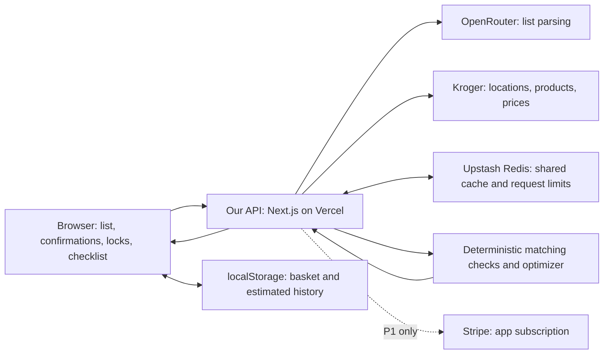

> **SUPERSEDED.** Kept for history only. This document describes an earlier design and no longer matches the app. The current sources of truth are [README.md](../../README.md), [SYSTEM.md](../../SYSTEM.md) and [pro-groceries-features.md](../../pro-groceries-features.md).

# Pro Groceries — Frontend, backend, data and API plan

> **Superseded for this hackathon demo:** use the [browser-only system design](SYSTEM.md). The server-based plan below is retained as an earlier proposal.

**Prepared:** November 14, 2026.  
**Scope:** [Six-feature MVP](pro-groceries-features.md) and [revised user flow](pro-groceries-userflow.md).  
**Status:** Recommended implementation, not a deployed product. Kroger credentials, access, quota and commercial terms have not been verified for this team.

## Recommended architecture

Use one Next.js/TypeScript application on Vercel. The frontend and our API share one domain. Next.js Route Handlers run the server logic as Vercel Functions. Use Upstash Redis for shared catalog/price cache, token caching and request limits. Keep the shopper's basket and estimated history in browser localStorage for P0.

OpenRouter supplies model inference. It does not replace the application server, the retailer's catalog or the deterministic optimizer. Our application calls the hosted OpenRouter API from its backend. [OpenRouter API reference](https://openrouter.ai/docs/api_reference/overview), [Next.js Route Handlers](https://nextjs.org/docs/app/getting-started/route-handlers), [Vercel Functions](https://vercel.com/docs/functions).



These are separate responsibilities:

| Component | What it provides | Who hosts it |
|---|---|---|
| Frontend | Grocery input, baseline selection, automatic-swap results, locks and shopping list | Our Vercel project |
| Our backend/API | Validation, orchestration, protected upstream calls, arithmetic and responses | Vercel Functions in the same project |
| Grocery data API | Available location/product data and store-specific prices | Kroger |
| AI inference API | Parse text into structured fields; optional evidence-grounded explanations | OpenRouter and its selected model provider |
| Shared cache | Retrieved retailer responses, timestamps, quotas/limits | Upstash Redis |
| Shopper state | Saved list, store, locks and estimated history | Shopper's browser for P0 |
| Subscription payments | Hosted checkout and billing events | Stripe; our backend verifies events in P1 |

The Vercel Marketplace supports external Redis providers including Upstash; Upstash documents its HTTP-based Redis client in Next.js/Vercel Functions. Do not plan around the retired Vercel KV product. [Vercel storage](https://vercel.com/docs/storage), [Redis on Vercel](https://vercel.com/docs/redis), [Upstash integration guide](https://upstash.com/docs/redis/quickstarts/vercel-functions-app-router).

## First dependency: obtain Kroger access

1. Open the [Kroger developer portal](https://developer.kroger.com/), register/sign in, and create an application.
2. Confirm that the application can use the relevant public Products and Locations APIs. Inspect the account's actual available API products, permissions and quota.
3. Retrieve the application's client ID and client secret. Put them only in `.env.local` locally and server-side environment variables in hosting. Do not paste credentials into chat or commit them.
4. Read the actual commercial-use and retention/caching terms. A technically working request does not independently establish commercial permission.
5. Obtain a server-to-server token and run one location search and one location-specific product search.
6. Inspect the real response shape and available attributes. Verify brand, description, size, variants, prices and eligible candidates before UI work relies on them.

The indexed Kroger documentation describes OAuth tokens and the request patterns below. Some indexed product pages are in the **partner** section; do not treat their full fields or limits as proof of entitlement for a newly registered public application. Current scope/access/registration from Kazakhstan remain an account-level smoke test. [Kroger documentation](https://developer.kroger.com/documentation), [Products documentation](https://developer.kroger.com/documentation/api-products/partner/products/overview).

### Upstream request patterns to verify

| Operation | Request | Purpose |
|---|---|---|
| Application token | `POST https://api.kroger.com/v1/connect/oauth2/token` | Client-credentials OAuth token; Basic auth with the server-held client ID/secret; form-encoded grant |
| Nearby branches | `GET https://api.kroger.com/v1/locations?filter.zipCode.near=45202` | Discover a real branch ID; do not hardcode an invented location ID |
| Product candidates | `GET https://api.kroger.com/v1/products?filter.term=spaghetti&filter.locationId=<selected-id>` | Query product data and supported location-specific prices |

Use the API's accepted product scope (documented as `product.compact` for product access) after confirming it in the portal. Read `expires_in` and refresh before expiry; do not assume the token lasts a fixed day. Public catalog lookup is an application credential flow; customer cart access is a separate authorization-code flow in P1.

**No full-catalog scrape:** search the user's item descriptions, deduplicate terms, retrieve bounded candidates, and cache permitted responses. Read daily limits from the actual account; this plan deliberately does not promise a fixed quota.

Run the included smoke check after creating `.env.local`:

```bash
node --env-file=.env.local scripts/probe-kroger.mjs
```

It uses three small upstream requests and prints a redacted field summary. It does not print client secrets, access tokens, or request authorization headers. It does not verify commercial terms or the entire matching/optimizer workflow.

## What data comes from where

| Data | Source | Missing-data behavior |
|---|---|---|
| Requested items and household locks | Shopper input and saved local state | Ask, retain original, or mark unresolved |
| Parsed product words/units/brand | OpenRouter output validated against a schema and user confirmation | Manual edit or retry; unknown stays unknown |
| Store identity and address | Actual Kroger location response | Unsupported/lookup-error state |
| Product ID/UPC, description, brand and size | Actual Kroger product/item records | Missing fields block dependent matches |
| Known variant attributes | Explicit retailer fields or deterministic extraction from product text; confirmed baseline | Unverified dietary/variant requirements block a swap |
| Regular/promo price | Selected product item/fulfillment at selected branch, if returned | Unpriced; no generated fallback |
| Promotion eligibility | Verified offer conditions plus shopper eligibility where needed | Exclude from unconditional total; optional separate conditional result |
| Package counts, unit prices and savings | Our deterministic engine | Reject incompatible units or incomplete inputs |
| Estimated history | Unique local comparison snapshots marked I shopped this | No receipt means no verified actual-spend claim |

The catalog is not assumed to contain complete nutrition, ingredients, allergy or certification data. The LLM cannot fill absent product facts from memory. For the first demo, use categories whose required attributes can actually be established.

## Frontend implementation

Use React client components for four small states rather than an agent-chat interface:

1. **List/store:** text box, sample list, ZIP, branch selector, parse progress and editable entries.
2. **Confirm originals:** likely baseline products with brand, variant, size and prices; unresolved coverage.
3. **Result:** automatically applied valid changes, totals, coverage, per-line Keep original, reason and source timestamp.
4. **Shopping/history:** full checklist, copy/share, local save, I shopped this, deduplicated estimate counter and Re-price.

Keep the state types shared with the backend. A confirmed product is represented by its ID and item/pack identity, not just a text label. Use integer cents for monetary values. Disable conflicting requests or discard outdated responses when the user changes store/quantities during retrieval.

For immediate locks, re-evaluate the already returned normalized snapshot using the same pure TypeScript calculation module. The server remains authoritative for data retrieval and any charged/billing operation. Refresh/reprice calls go back to the server. Browser-stored totals are untrusted historical display, not entitlement or proof of price validity.

## Backend endpoints we build

These `/api/*` paths are our design, not Kroger or OpenRouter endpoints. Keep public actions bounded because the core has no login.

| Endpoint | Input | Output / responsibility |
|---|---|---|
| `POST /api/parse-list` | Raw list text | Validated parsed entries with unknowns; server-side OpenRouter call |
| `GET /api/stores?zip=45202` | Validated US ZIP | Normalized supported branches from Kroger/cache |
| `POST /api/match` | Store ID and parsed entries | Bounded baseline candidates and match coverage |
| `POST /api/optimize` | Store ID, confirmed baseline IDs, quantities, locks, eligibility | Retrieved/revalidated baseline + alternative snapshot and computed comparison |
| `POST /api/reprice` | Same basket inputs, explicit refresh intent | Refreshed/revalidated comparison, timestamps, cache metadata and failure state |
| `GET /api/health` | None | Configuration presence/status only; never secrets or token contents |

The browser does not supply trusted prices. Optimize/reprice look up product records on the server or validate a server-issued snapshot reference. Bind confirmations to their expected product and pack to detect accidental product changes.

Rate-limit costly public endpoints using the shared cache; bound input length, item count, candidate count and concurrency. Keep requests within hosting runtime budgets. Avoid one upstream request per keystroke or one LLM call per item. On upstream errors show the actual failed stage with retry; do not silently use fixtures.

## OpenRouter setup and use

1. Create/sign in to an [OpenRouter account](https://openrouter.ai/) and create an API key with an appropriate spending limit.
2. Set `OPENROUTER_API_KEY` only on the server. Set `OPENROUTER_MODEL` to a currently available model whose selected endpoint supports structured outputs; verify it against several sample lists before pinning it.
3. Send a bounded server-side request to `https://openrouter.ai/api/v1/chat/completions` with Bearer authorization.
4. Use `response_format.type = json_schema`, a strict schema where supported, and provider preferences requiring supported parameters. Validate the returned message content again in our code.
5. Prompt for extraction only. The schema includes description, explicit brand/variant, package count, pack amount/unit and unresolved questions. **No price, discount, total or saving fields.**
6. Preserve null for unstated facts. Schema compliance does not establish that the extracted fact is correct; the shopper can edit it.

Structured-output availability depends on the selected model/provider endpoint. The OpenRouter documentation recommends checking supported parameters and requiring them in routing. [Structured outputs](https://openrouter.ai/docs/guides/features/structured-outputs).

For P0, explanations can use deterministic templates. If an explanation model is added, provide only the confirmed product facts and a reason code. Render dollar amounts from engine output, not free-form model text. Do not add multi-agent orchestration, web search or model-driven purchases to this path.

## Optimizer module

Implement a pure module with explicit inputs and outputs:

```text
confirmed original + candidate records + requested quantity + locks + eligible price context
    → validate type/variant/required evidence
    → normalize units
    → compute integer packages for every size
    → compute checkout cost in integer cents
    → keep cheapest eligible candidate or original
    → return choices + exclusions + provenance + totals
```

This is independent per-line minimization over the fetched candidates. It is not proof of the cheapest possible basket across the full catalog. The ±10% pack grouping in the feature document never overrides full-quantity arithmetic.

Baseline and replacement must use the same membership/fulfillment assumptions. A missing product price on either side removes that line symmetrically from priced totals and reduces coverage. A price of zero must not automatically be treated as a valid free product.

Required tests: unit dimensions, integer package coverage, locked items, unknown variants, conditional promos, missing prices, zero-saving cases, exact lock recalculation, and repeated history events. Use real API-record samples for parsing tests after access works; fixtures are for tests, not production pricing.

## Cache and persistent state

- **Redis:** application token with expiry, permitted raw/normalized retailer responses, query indexes and rate-limit counters. Cache keys include branch, query/product/item identity, fulfillment/eligibility context and schema version.
- **Price age:** the feature document proposes under 24 hours. Confirm the upstream terms first; use that as a configurable maximum, not a statement that prices never change within a day. Effective expiry must also respect any known promotion end time.
- **Manual reprice:** attempt an upstream refresh with request coalescing/quota protection. If using a still-valid cache instead, explicitly report that fact and its original retrieval time. A failed refresh is not a successful fresh check.
- **localStorage:** stable basket ID, list, baseline IDs, locks, dated comparison snapshots, shop markers, and versioned week keys. Provide Clear my data and handle corrupted/unavailable storage.
- **No runtime filesystem cache:** do not depend on writing durable cache files inside a serverless function. Commit the cache-filling script, not customer data or secrets.

P0 does not need an account database. P1 payment does need a durable, recoverable entitlement record and webhook deduplication; a browser token must resolve to/validate against that server state.

## Hosting and deployment

Recommended: **one Next.js project on Vercel + Upstash cache + OpenRouter inference + Kroger data**. Select hosting plans appropriate for the intended usage; this document makes no free-commercial-hosting or fixed-cost promise.

1. Put the application in the Pro Groceries repository and choose a supported Node.js runtime.
2. Deploy the Next.js project to Vercel; its frontend and `/api/*` routes share the generated HTTPS domain.
3. Provision Upstash Redis and set the server environment variables in the deployment dashboard.
4. Add Kroger/OpenRouter secrets to production and preview environments as appropriate. Never prefix secrets with `NEXT_PUBLIC_`.
5. Deploy/redeploy after configuration. Verify the public production URL without a hosting login wall, including on a fresh device.
6. Check parse → store → baseline → optimize → lock → copy → reload → reprice. Confirm live source timestamps and that no fixture-price path is reachable.
7. Run all ten evaluation baskets and include failures. Only then attempt optional Stripe/cart/photo work.

Vercel Functions and Next.js Route Handlers support the proposed combined frontend/backend layout. [Functions documentation](https://vercel.com/docs/functions), [Route Handlers](https://nextjs.org/docs/app/getting-started/route-handlers).

## Suggested project structure

```text
app/page.tsx
app/api/parse-list/route.ts
app/api/stores/route.ts
app/api/match/route.ts
app/api/optimize/route.ts
app/api/reprice/route.ts
components/                    # four small screen states
lib/server/kroger.ts            # OAuth, upstream requests, bounded retries
lib/server/openrouter.ts        # schema-constrained extraction
lib/server/cache.ts             # shared cache and rate limits
lib/domain/types.ts
lib/domain/units.ts
lib/domain/equivalence.ts
lib/domain/optimize.ts          # pure deterministic calculations
lib/client/basket-storage.ts
scripts/probe-kroger.mjs        # included dependency smoke check
scripts/fill-price-cache.mjs    # implement after permitted cache strategy is known
tests/                         # meaningful engine and adapter tests
.env.example
```

Only documentation, the board, the environment template and the smoke-check script are created in this planning task. The Next.js app, endpoint handlers, shared cache and cache-filling script above are proposed implementation files, not existing services.

## Build order for two people

| Stage | Frontend/product owner | Backend/engine owner | Exit condition |
|---|---|---|---|
| Dependency check | Confirm list/category scope and live demo basket | Register Kroger, run smoke check, inspect real fields and terms | One branch with usable real prices and candidate matches |
| Contracts | Build editable list and confirmation states | Agree normalized types and response contracts | Both sides consume the same shapes |
| Core implementation | Result/locks/checklist/local persistence | Parsing endpoint, retailer adapter, cache, pure engine and tests | Full six-feature flow works |
| Production verification | Fresh browser/mobile run; ten real lists | Deploy, bound public requests, verify provenance and failures | Actual production URL passes acceptance checks |
| Optional scope | Price panel and checkout UI | Verified Stripe events/entitlements; cart only if granted | P0 remains usable without optional services |

Ownership is a proposal; assign it to your confirmed skills. The first go/no-go is retailer access, not the choice of AI model.
